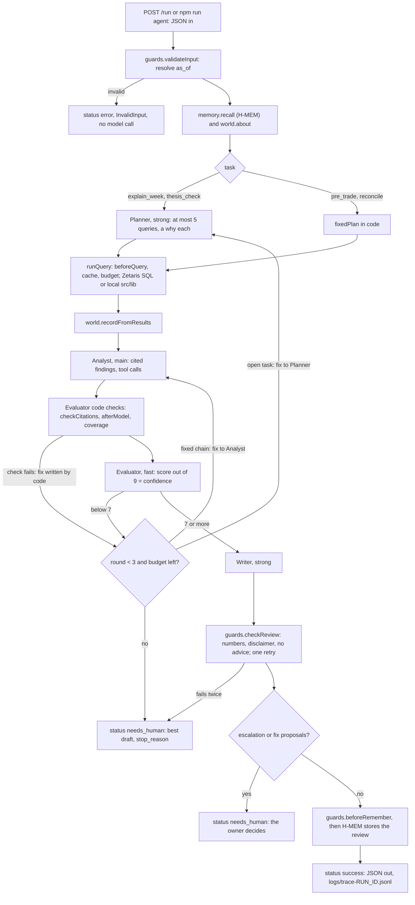

# Tradeflow AI layer: build plan

Plan Mode draft, written on October 22, 2026, from the repo at commit `91e4cfc`. After you approve it, I save it as `docs/PLAN.md` (the path that `AGENTS.md` names). That is this repo's "Save to workspace". Answer the questions in section 7 before step 1.

I didn't read `.hackathon-prep/`, because `.claude/settings.json` denies it. Facts about the organizers' guides come from your prompt only.

## 1. Summary

Tradeflow gets a small team of review agents on top of the ledger that existed at the tag `pre-hackathon`. One bounded loop in `src/agent/orchestrator.ts` runs four tasks: `explain_week` (A1), `thesis_check` (A2), `pre_trade` (A3) and `reconcile` (A4). Code alone handles `feedback` (A5) and `briefing` (A8), and a Router (A6) picks the task when a request has none. The Planner (strong model) picks at most five named queries. Code runs each query through `guards.beforeQuery`, a per-run cache and the budget, on Zetaris Lightning SQL with a local `src/lib` fallback. The Analyst (main model) writes findings that cite a `run_query_id` for every number, and it can call the task's queries as native tools. The Evaluator checks the draft in code, then scores it with the fast model. A total below 7 of 9 goes back for revision, for up to three rounds. The Writer (strong model) writes the review, and code checks every number, the disclaimer and the wording. H-MEM recalls the owner's rules, theses, past reviews and corrections before the run and stores the accepted review after it. The World Model keeps facts from query rows with their source. Every model call goes to Meterless Nightshift at `METERLESS_BASE_URL`, and every step writes one trace line. Sample mode runs the same code with `sample-model.ts` on local data. The agents never give trading advice, never save a trade, and change the ledger only after the owner approves.

One run, from request to saved review (every box writes a trace line):



## 2. File tree after the build

Labels: **new**, **pre-existing** (unchanged), and **pre-existing, allowed edit** (only the edits that `AGENTS.md` rule 1 allows).

```text
tradeflow/
  AGENTS.md, CLAUDE.md, .cursor/, .claude/, .githooks/, .cursorignore   pre-existing (kit)
  CURSOR.md                          pre-existing (kit): one row per step
  PRE-EXISTING.md                    pre-existing, allowed edit: appended lines only
  README.md                          pre-existing, allowed edit
  package.json                       pre-existing, allowed edit: scripts; zod, tsx, @modelcontextprotocol/sdk
  package-lock.json                  pre-existing; changes only with those dependencies
  tsconfig.json                      pre-existing, allowed edit: allowImportingTsExtensions only
  .env.example, .gitignore           pre-existing, allowed edit: new lines only
  Dockerfile, docker-compose.yml, .dockerignore         pre-existing (run with -e PORT=8000)
  eslint.config.mjs, vitest.config.mts, next.config.ts  pre-existing
  metadata.json                      new (step 21)
  data/                              pre-existing; data/memory/ is git-ignored and written at runtime
  docs/PLAN.md                       new (this plan)
  docs/zetaris-queries.md            new, written by npm run parity (steps 4 and 17)
  evals/expectations.json            pre-existing (kit), never weakened
  evals/redteam/cases.json           pre-existing (kit), never weakened
  evals/redteam/fixtures/<case>/     new, written by scripts/make-fixtures.ts (step 15)
  evals/RESULTS.md                   new, written by npm run eval (step 15)
  input_examples/example_*.json      new: 11 files that expectations.json names, plus example_9 (steps 9-19)
  output_examples/<example>.json     new, from real-model runs (step 15)
  output_examples/traces/            new: copies of trace files and H-MEM's ledger.jsonl (step 15)
  logs/                              git-ignored: trace-<run_id>.jsonl, run-<run_id>.json
  vendor/hmem/                       new: copy of meterless engines/hmem/reference/src + LICENSE (step 5)
  vendor/world-model/                new: copy of engines/world-model/reference/src + LICENSE (step 12)
  scripts/seed.mjs, seed-data.mjs, load-postgres.mjs, db-schema.mjs     pre-existing
  scripts/claude-kit.test.mjs        pre-existing (kit)
  scripts/try-model.ts               new (step 2)
  scripts/parity.ts                  new (step 4)
  scripts/agent.ts                   new (step 9)
  scripts/eval.ts, make-fixtures.ts  new (step 15)
  scripts/clean-clone.sh             new (step 16)
  scripts/mcp-tools.ts, mcp-server.ts, mcp-tools.test.ts                new (step 20)
  src/lib/**, src/test/**, src/components/**                            pre-existing
  src/components/ui/app-shell.tsx    pre-existing, allowed edit: one nav link (step 13)
  src/app/api/** and every existing page                                pre-existing
  src/app/run/route.ts               new (step 9): POST /run
  src/app/run/[run_id]/route.ts      new (step 9): GET /run/<run_id>
  src/app/run/[run_id]/approve/route.ts   new (step 17): POST, applies approved fixes
  src/app/explain/page.tsx, view.tsx, page.test.tsx   new (step 13)
  src/app/explain/runs/[run_id]/page.tsx, view.tsx   new (step 18): trace viewer
  src/app/explain/queue/page.tsx, view.tsx           new (step 18): review queue
  src/agent/
    config.ts, trace.ts, types.ts               new (step 1)
    llm.ts, sample-model.ts                     new (step 2)
    queries.ts                                  new (step 3); sql() in steps 4 and 17
    zetaris.ts                                  new (step 4)
    memory.ts, concurrency.ts, testing.ts       new (step 5)
    guards.ts                                   new (step 5: beforeRemember; step 6: the rest)
    policy.ts, run-state.ts, context.ts         new (step 6)
    prompts.ts, agents/planner.ts, agents/analyst.ts               new (step 7)
    agents/evaluator.ts, agents/writer.ts, orchestrator.ts         new (step 8)
    world.ts                                    new (step 12)
    proof.ts                                    new (step 13)
    metrics.ts                                  new (step 15)
    reconcile-fix.ts                            new (step 17)
    router.ts, registry.ts                      new (step 18)
    prompts/planner.md, analyst.md, evaluator.md, writer.md        pre-existing (kit)
    prompts/router.md                           new (step 18)
    *.test.ts, agents/*.test.ts                 new, beside the code they test
```

## 3. Steps

Every step also does what `AGENTS.md` "Done means" asks. It runs `npm run check`, adds tests for new behavior, updates the README for what changed, appends one row to `CURSOR.md`, and makes one commit with a one-line conventional message. Tests that run the orchestrator, memory or a route use `TRADEFLOW_DATA_DIR` pointed at a temporary copy of `data/`. Unit tests never touch the network.

Shared types used in the signatures (defined in `src/agent/types.ts`, step 1, unless noted):

```ts
type Task = "explain_week" | "thesis_check" | "pre_trade" | "reconcile" | "feedback" | "briefing";
type Tier = "strong" | "main" | "fast";
type AgentName = "Planner" | "Analyst" | "Evaluator" | "Writer" | "Router";
type Usage = { model_calls: number; query_calls: number; tokens_in: number; tokens_out: number; duration_ms: number };
type ErrorType = "InvalidInput" | "MissingKey" | "Unauthorized" | "NightshiftNotRunning" | "BadJson" | "Timeout" | "Internal";
type Cell = string | number | boolean | null;
type Row = Record<string, Cell>;
type RunInput = {
  task?: Task; question: string; as_of?: string;
  trade?: { symbol: string; side: "buy" | "sell"; quantity: number; price?: number | null };
  plan_id?: string; journal_ids?: string[]; symbols?: string[];
  feedback?: { run_id: string };
  options?: { sample_mode?: boolean; run_id?: string };
};
type RunResult = {
  run_id: string; status: "success" | "needs_human" | "error"; task: Task | null; as_of: string | null;
  output: RunOutput | null; error: { type: ErrorType; message: string; recoverable: boolean } | null;
  usage: Usage; trace_file: string;
};
type RunOutput = {
  summary: string; review_markdown: string; findings: Finding[]; gaps: string[];
  evidence: Record<string, { query_id: QueryId; params: unknown; source: string; rows: Row[] }>; // cited rows only
  declined_advice: boolean; injection_seen: boolean;
  escalation: Escalation | null; proposals: Proposal[]; new_findings: number | null;
  rounds: number; accepted_round: number | null; scores: Scores[];
  model_source: "nightshift" | "sample"; models: Record<Tier, string>;
  memories_recalled: { id: string; tags: string[] }[]; applied_corrections: string[]; memory_added: boolean;
  partial: boolean; stop_reason: StopReason | null;
  children?: { task: Task; run_id: string; status: RunResult["status"] }[];
};
```

### Step 1. Config and tracer

- **Goal:** keep every limit, model id and setting in one module, and write every trace line to stdout and `logs/trace-<run_id>.jsonl`.
- **Files:** `src/agent/config.ts`, `src/agent/trace.ts`, `src/agent/types.ts`, `config.test.ts`, `trace.test.ts`; `package.json` (add `zod` and `tsx`); `.env.example` (new lines: `SAMPLE_MODE`, `METERLESS_BASE_URL`, `METERLESS_API_KEY`, `NEMOTRON_MODEL_STRONG`, `NEMOTRON_MODEL_MAIN`, `NEMOTRON_MODEL_FAST`, `MAX_TOKENS_PER_RUN`, `PORT`).
- **Functions:**

  ```ts
  // config.ts
  type Limits = {
    MAX_PLANNED_QUERIES: 5; MAX_ROUNDS: 3; MAX_QUERY_CALLS: 20; MAX_MODEL_CALLS: 12; MAX_TOOL_ROUNDS: number; // question 14
    MAX_TOKENS_PER_RUN: number; QUERY_TIMEOUT_MS: 20000; MODEL_TIMEOUT_MS: 180000; MODEL_TIMEOUT_STRONG_MS: 180000;
    ROUND_TIMEOUT_MS: 300000; RUN_TIMEOUT_MS: 600000; MAX_ROWS_PER_QUERY: 50; MAX_MEMORIES: 5;
    MAX_PROMPT_CHARS: number; TEMPERATURE: 0.2; MAX_COMPLETION_TOKENS: number; PASS_TOTAL: 7;
  };
  type Config = {
    limits: Limits; models: Record<Tier, string>;
    meterless: { baseUrl: string; apiKey: string; headers: { "meterless-app": "tradeflow"; "meterless-scope": "user" } };
    zetaris: { restUrl: string; apiKey: string; orgId: string } | null;
    sampleMode: "true" | "false" | "auto"; logDir: string;
  };
  export function loadConfig(env?: NodeJS.ProcessEnv, overrides?: Partial<Limits>): Config;
  export function decideSampleMode(cfg: Config, requested?: boolean):
    { sample: boolean; reason: string } | { error: "MissingKey"; message: string };
  export function publicModels(cfg: Config, sample: boolean): { source: "nightshift" | "sample"; models: Record<Tier, string> }; // never a key or URL
  // trace.ts
  type TraceStatus = "ok" | "retry" | "fallback" | "cached" | "rejected" | "accepted" | "needs_human" | "error";
  type TraceLine = {
    timestamp: string; run_id: string; agent_name: string; action: string; input_summary: string; output_summary: string;
    target_agent: string | null; model: string | null; confidence: number | null; retry_count: number; status: TraceStatus;
    why?: string; duration_ms?: number; usage?: Partial<Usage>;
  };
  export class Tracer {
    constructor(runId: string, opts?: { dir?: string; stdout?: boolean });
    readonly runId: string; readonly file: string;
    log(line: Omit<TraceLine, "timestamp" | "run_id">): TraceLine; // appendFileSync, so lines keep their order
    lines(): readonly TraceLine[];
  }
  export function newRunId(): string;           // run-YYYYMMDD-HHMMSS-<6 hex>
  export function isRunId(s: string): boolean;  // stops path traversal in GET /run/<run_id>
  export function summarise(value: unknown, max?: number): string; // short; redacts key-like strings and URLs
  export function readTrace(runId: string, dir?: string): Promise<TraceLine[]>;
  ```

- **Tests:** each limit has the value your prompt fixes, or the value you choose in question 14; `decideSampleMode` against the full `AGENTS.md` rule 11 table (`SAMPLE_MODE` `true`, `false` or empty, by keys present or missing, by request `true`, `false` or absent); a trace line carries every required field; lines append in order; `summarise` redacts an `nvapi-` key; `isRunId("../x")` is false.
- **Proves it:** `npx vitest run src/agent/config.test.ts src/agent/trace.test.ts`
- **Biggest risk:** the sample-mode table has three settings and a request override, which is easy to get subtly wrong. The table-driven test is the guard.
- **Commit:** `feat(agent): add config limits and the JSONL tracer`

### Step 2. Model client and sample model

- **Goal:** one OpenAI-compatible client for Nightshift with timeouts, one retry, the strong-to-main fallback and typed errors, plus an offline sample model with the same interface.
- **Files:** `src/agent/llm.ts`, `src/agent/sample-model.ts`, `llm.test.ts`, `sample-model.test.ts`, `scripts/try-model.ts`; `package.json` script `try-model` (`node --env-file-if-exists=.env --import tsx scripts/try-model.ts`).
- **Functions:**

  ```ts
  type ToolSpec = { type: "function"; function: { name: string; description: string; parameters: Record<string, unknown> } };
  type ToolCall = { id: string; name: string; arguments: string };
  type ChatMessage = { role: "system" | "user" | "assistant" | "tool"; content: string; tool_calls?: ToolCall[]; tool_call_id?: string };
  type ChatRequest = { agent: AgentName; tier: Tier; system: string; messages: ChatMessage[]; tools?: ToolSpec[];
    reasoning?: "off"; timeoutMs: number; tracer: Tracer };
  type ChatReply = { text: string; toolCalls: ToolCall[]; model: string; tier: Tier; fellBackFrom: Tier | null;
    usage: { tokens_in: number; tokens_out: number }; retries: number };
  interface ModelClient { readonly source: "nightshift" | "sample"; chat(req: ChatRequest): Promise<ChatReply> }
  export function createNightshiftClient(cfg: Config, fetchImpl?: typeof fetch): ModelClient;
  export function stripReasoning(text: string): string;  // removes <think> blocks and code fences
  export function parseJsonReply<T>(text: string, schema: z.ZodType<T>): T;
  export async function chatJson<T>(client: ModelClient, req: ChatRequest, schema: z.ZodType<T>):
    Promise<{ value: T; reply: ChatReply }>;              // asks again once on unparseable JSON, then BadJson
  export async function listModels(cfg: Config, fetchImpl?: typeof fetch): Promise<string[]>; // GET {base}/models
  export class BadJson extends Error {}
  export class Unauthorized extends Error {}            // 401 or 403; never falls back
  export class NightshiftNotRunning extends Error {}    // refused connection; never falls back
  export class ModelTimeout extends Error {}
  // sample-model.ts
  export function createSampleModel(): ModelClient;     // dispatch by req.agent; replies built from the user JSON only
  ```

  Each agent step adds its own deterministic rule to `sample-model.ts` (steps 7, 8, 10, 11, 17 and 18). Token usage in sample mode is estimated as characters divided by four, so the token budget applies there too.
- **Tests:** with a fake `fetch`: the request has `Authorization: Bearer`, `meterless-app: tradeflow`, `meterless-scope: user`, temperature 0.2 and the completion-token cap; the URL comes only from config; `429` then `200` gives one retry and a `retry` trace line; strong `404` falls back to main with a `fallback` line and a why; two strong timeouts fall back to main; main `404` is an error; `401` throws `Unauthorized`; `ECONNREFUSED` throws `NightshiftNotRunning`; `parseJsonReply` strips `<think>` and fences; `chatJson` asks again once, then throws `BadJson`. The sample model gives the same reply for the same input and never calls `fetch`.
- **Proves it:** `npm run try-model` (lists `GET /models`, sends one JSON-only prompt and one tool-call prompt to each tier, and prints the model that answered and whether `tool_calls` came back).
- **Biggest risk:** Nightshift's contract has gaps I couldn't verify: whether `tools` pass through, how to turn reasoning off for the fast model, `max_tokens` or `max_completion_tokens`, and where the served lane appears. `try-model` answers all four on day 1.
- **Commit:** `feat(agent): add the Nightshift model client and the sample model`

### Step 3. Named queries (local)

- **Goal:** register the nine named queries, each with zod params, a Planner description and a `local()` that calls the same `src/lib` function as its API.
- **Files:** `src/agent/queries.ts`, `queries.test.ts`.
- **Functions:**

  ```ts
  type QueryId = "week_moves" | "sector_vs_stock" | "announcements_between" | "fundamentals_latest"
    | "dividends_between" | "journal_for_symbol" | "rule_findings" | "what_if" | "reconciliation";
  type QueryData = { portfolio: PortfolioData; sectorBars: SectorIndexBar[]; announcements: Announcement[];
    fundamentals: Fundamental[]; journal: JournalEntry[]; broker: BrokerStatementRow[]; bank: BankDepositRow[] };
  type NamedQuery<P> = { id: QueryId; description: string; params: z.ZodType<P>; tasks: Task[];
    local(p: P, d: QueryData): Row[];
    sql?(p: P): string; sqlColumns?: string[]; merge?(sqlRows: Row[], p: P, d: QueryData): Row[] };
  export async function loadQueryData(): Promise<QueryData>; // loadPortfolioData, loadSectorIndexBars, loadAnnouncements,
                                                              // loadFundamentals, loadJournal, loadBrokerStatement, loadBankDeposits
  export const QUERIES: { [K in QueryId]: NamedQuery<unknown> };
  export function runLocal(id: QueryId, params: unknown, d: QueryData): Row[];
  export function toolSpecs(task: Task): ToolSpec[]; // name = id, description, z.toJSONSchema(params)
  ```

  What each `local()` calls and returns:

  | Query | Params | `src/lib` call | Rows |
  |---|---|---|---|
  | `week_moves` | `as_of` | `attributionAsOf` with `WEEK_SESSIONS`; `weightPct` from `buildPortfolioView` | A `PORTFOLIO` row (`change_pct`, `index_change_pct`, `vs_index_pts`, `change_bdt`), then holdings by absolute `contribution_bdt` with `from_close`, `to_close`, `change_pct`, `sector_change_pct`, `vs_sector_pts`, `comparison`, `weight_pct` |
  | `sector_vs_stock` | `as_of` | `sectorMovesAsOf` | Each sector index and DSEX: `from_date`, `to_date`, `close`, `change_pct` |
  | `announcements_between` | `from`, `to`, `symbols?` | `filterAnnouncements` | `id`, `symbol`, `published_on` (`publishedYmd`), `category`, `price_sensitive`, `title`, `body` (cut to 400 characters, as data) |
  | `fundamentals_latest` | `as_of`, `symbol?` | `summariseFundamentals`, with the last close as `GET /api/fundamentals` gets it | One row per quarter; the latest row adds `eps_change_pct`, `net_profit_change_pct`, `trailing_pe`, `pe_basis` |
  | `dividends_between` | `from`, `to` | `buildPortfolioView(...).dividends` (`dividendsFor`); `addDseTradingDays(record_date, 1)` for the ex-date, the session after the record date (`DividendView` has no ex-date, so this column is derived) | `action_id`, `symbol`, `record_date`, `ex_date`, `paid_on`, `shares`, `cash_per_share_bdt`, `amount_bdt`, `paid` |
  | `journal_for_symbol` | `as_of`, `symbol?` | `journalForSymbol` on `dataUpTo(...).transactions`; every entry when no symbol | `id`, `transaction_id`, `symbol`, `trade_date`, `price_per_share`, `quantity`, `thesis`, `horizon`, `exit_condition`, `tags` |
  | `rule_findings` | `as_of` | `buildPortfolioView(...).findings`, plus the open plans in that view's `rules.trade_plans` | `row_type` `finding` (`kind`, `subject`, the actual and limit or target figures, `delta_pct`, `message`) and `row_type` `plan` (`id`, `symbol`, `side`, `target_price`, `note`), so the owner's plan notes reach the models as data |
  | `what_if` | `as_of`, `symbol`, `side`, `quantity`, `price?` | `previewTrade` | `row_type` `trade`, `holding` (weight before and after), `sector` (before and after) and `new_finding` |
  | `reconciliation` | none | `reconcile` | One row per issue: `issue_id`, `kind`, `ref`, `ledger_id`, `date`, `symbol`, `field`, `broker_value`, `ledger_value`, `difference_bdt`, `amount_bdt` |

- **Tests:** checked against the planted figures in `data/README.md`. On 2026-10-01 the portfolio moves about -1.7% and -0.9 points against DSEX, BXPHARMA moves -14.9%, and only BXPHARMA and SQURPHARMA are "stock-specific". On 2026-09-17 the portfolio is +1.2 points against DSEX. GP's `ca-07` shows Tk 3,000 owed and not paid on 2026-09-24. BXPHARMA's EPS reads 2.30, 2.05 and 1.62. The journal on 2026-04-10 excludes `j-014`. Rule findings on 2026-10-01 include SQURPHARMA above 25%. `what_if` gives a new `sector_target` finding for `p-02` and none for `p-03`. Reconciliation has exactly four issues. Changing `as_of` changes the result.
- **Proves it:** `npx vitest run src/agent/queries.test.ts`
- **Biggest risk:** every prompt, guard and sample-model rule reads these row shapes, so a later rename ripples everywhere. The planted-case tests fix the shapes now.
- **Commit:** `feat(agent): add the nine named queries over src/lib`

### Step 4. Zetaris adapter and parity

- **Goal:** run `week_moves`, `sector_vs_stock`, `announcements_between`, `fundamentals_latest` and `journal_for_symbol` as one Lightning SQL statement each through the Zetaris REST API as `zetaris_ro`, with a local fallback, and prove they match.
- **Files:** `src/agent/zetaris.ts`, `zetaris.test.ts`; `queries.ts` (`sql()`, `sqlColumns`, `merge`, `fetchRows`); `scripts/parity.ts`; `docs/zetaris-queries.md` (generated); `.env.example` (`ZETARIS_REST_URL`, `ZETARIS_API_KEY`, `ZETARIS_ORG_ID`, pending question 1); `package.json` script `parity`.
- **Functions:**

  ```ts
  // zetaris.ts, adapted from zetaris/getting-started scripts/zetaris_api.ts and zetaris_sql.py (Apache-2.0)
  interface ZetarisClient { run(sql: string, opts: { timeoutMs: number }): Promise<{ data: Cell[][]; durationMs: number }> }
  export function createZetarisClient(cfg: Config["zetaris"], fetchImpl?: typeof fetch): ZetarisClient | null;
    // POST {ZETARIS_REST_URL}/sql-editor/sqls/run, body { queryId, sql, source: "SqlEditor", limit },
    // headers Authorization: Bearer, X-Org-ID, a fresh UUID X-Request-ID; one retry on a timeout only
  export function toNumber(v: Cell): number | null;  // "0E-18" -> 0, "12.50" -> 12.5
  export function rowsFromArrays(columns: string[], data: Cell[][], numeric: ReadonlySet<string>): Row[];
  export class ZetarisTimeout extends Error {}
  // queries.ts
  export function table(ds: "tradeflow_ledger" | "tradeflow_external", name: string): string; // the form SHOW DATASOURCE TABLES lists
  export async function fetchRows(id: QueryId, params: unknown,
    deps: { data: QueryData; zetaris: ZetarisClient | null; tracer: Tracer; timeoutMs: number }):
    Promise<{ rows: Row[]; source: "zetaris" | "local" | "local-fallback"; sqlHead: string | null }>;
  // scripts/parity.ts
  async function main(): Promise<void>; // each sql() query on fixed params, both ways; compares sqlColumns; writes the doc; exit 1 on a difference
  ```

  SQL shape. Rows come back as positional string arrays, so `sqlColumns` lists the `SELECT` order. Only zod-validated dates and known symbols are put into SQL, never free text. Dhaka-day windows become absolute instants, for example `CAST('2026-10-02T00:00:00+06:00' AS TIMESTAMP)`, so the result doesn't depend on the session time zone.
  - `week_moves`: held symbols (net quantity above 0 up to the end of `as_of`), then `ROW_NUMBER() OVER (PARTITION BY symbol ORDER BY bar_date DESC)` on `bars` to get `symbol, from_close, to_close, change_pct`. `merge` adds the `PORTFOLIO` row and the label from `src/lib`.
  - `sector_vs_stock`: the same window on `sector_index_bars` and `index_bars`, combined with `UNION ALL`.
  - `announcements_between`, `fundamentals_latest` and `journal_for_symbol`: filtered selects. `journal_for_symbol` joins `journal` to `transactions`. `tags` (`text[]`) and `body` stay in `merge` until array support is confirmed.
- **Tests:** with a fake `fetch`: the headers, a UUID request id, no trailing semicolon, string numbers converted, `0E-18` read as 0, a timeout retried once then `ZetarisTimeout`. `fetchRows` falls back to local with a `fallback` trace line and source `local-fallback`. With no client the source is `local`. `what_if` never calls Zetaris, and its trace says so. Each `sql()` is one statement with qualified names. A symbol outside `instruments` is refused before it reaches SQL.
- **Proves it:** `npm run parity`
- **Biggest risk:** the Lightning SQL dialect is unproven for Postgres sources. The getting-started docs confirm limits only for REST and file sources, and they say nothing about `timestamptz` or `text[]`. Simplify first: run parity on one `as_of`, and leave more columns to `merge`. Never move a query off Zetaris.
- **Commit:** `feat(agent): run five named queries through Zetaris with parity`

### Step 5. H-MEM memory

- **Goal:** keep the owner's memory in the Meterless H-MEM engine: seed rules, profile and theses, recall before a run, and store accepted reviews.
- **Files:** `vendor/hmem/` (the 10 files of `/Users/cefalo/sandbox/meterless/engines/hmem/reference/src`, unchanged, with `LICENSE`); `tsconfig.json` (`allowImportingTsExtensions: true`); `src/agent/memory.ts`, `memory.test.ts`; `src/agent/concurrency.ts`; `src/agent/guards.ts` (`beforeRemember` only) and `guards.test.ts`; `src/agent/testing.ts` (test helpers); `package.json` (`lint` gets `--ignore-pattern vendor/` if the copy fails the repo's eslint rules).
- **Functions:**

  ```ts
  // concurrency.ts
  export function withLock<T>(key: string, fn: () => Promise<T>): Promise<T>; // in-process FIFO lock per data dir
  // memory.ts
  import { HMEM } from "../../vendor/hmem/index.ts";
  type RecalledMemory = { id: string; tags: string[]; content: string; relevance: number; via: "tag" | "query" };
  export function memoryDir(): string;            // path.join(dataDir(), "memory"): state.json and ledger.jsonl
  export function openMemory(dir?: string): HMEM; // one cached instance per dir; the engine keeps state in memory
  export async function seedOwnerMemory(a: { rules: Rules; profile: Profile; journal: JournalEntry[];
    transactions: TransactionRow[]; tracer: Tracer }): Promise<{ added: number }>;
    // idempotent by source "seed:<id>": limits, sector targets, open trade plans and profile as "preference";
    // journal theses as "personal" with tag "thesis"
  export async function recall(question: string, asOf: string, tracer: Tracer): Promise<RecalledMemory[]>;
  export async function remember(a: { content: string; asOf: string; runId: string; task: Task; tracer: Tracer }):
    Promise<string | null>;                       // type "general", tags "review" and as_of; through beforeRemember
  // guards.ts
  type GuardResult = { ok: true } | { ok: false; reason: string };
  export function beforeRemember(e: { kind: "review" | "correction" | "thesis" | "preference"; content: string;
    accepted?: boolean; source: string }, tracer: Tracer): GuardResult;
  // testing.ts
  export async function tempDataDir(): Promise<{ dir: string; cleanup(): Promise<void> }>;
  ```

  `recall` follows `memory.mdc`. First it takes every memory tagged `correction`, and the `review` with the latest date tag before `asOf`, by tag and without a threshold. Then it fills up to `MAX_MEMORIES` from `hmem.query(question, { topN: 5, threshold: 0.35 })`. It traces the ids that came by tag and the query's `trace.retrievalReason` and `trace.strategy` (the reference puts both under `trace`, not on each memory). `add()` and `store.update()` are synchronous in the reference, and they run inside `withLock`.
- **Tests:** seeding twice adds nothing the second time; recall finds the position-limit rule for a question about limits; a review stored for 2026-09-24 is recalled by tag on 2026-10-01 and not on 2026-09-24; never more than five memories; the trace line has `retrievalReason` and `strategy`; files land in `<data dir>/memory`. `beforeRemember` allows an accepted review and denies raw rows, a key-like string and an unaccepted review.
- **Proves it:** `npx vitest run src/agent/memory.test.ts`
- **Biggest risk:** the copied ESM files (with `.ts` import extensions) must pass `tsc --noEmit`, `next build` and eslint here, and rule 1 allows only one `tsconfig.json` change. Simplify first: if the copy fails a strict check that a `package.json` script can't skip, implement the same API from the reference architecture in `src/agent/hmem/` and call it that, as `memory.mdc` says.
- **Commit:** `feat(agent): add H-MEM owner memory from the Meterless reference`

### Step 6. Runtime guards

- **Goal:** put a guard in front of every query, model reply, citation and review, and add the per-run budget, cache, result store and context limits.
- **Files:** `src/agent/guards.ts` (adds the rest), `src/agent/policy.ts`, `src/agent/run-state.ts`, `src/agent/context.ts`; `guards.test.ts`, `run-state.test.ts`, `context.test.ts`; README guard table.
- **Functions:**

  ```ts
  // policy.ts
  export const DISCLAIMER = "This is a review of your own records, not financial advice.";
  export function adviceIn(text: string): string | null;     // "you should buy", "go ahead and buy", "sell now"
  export function injectionIn(text: string): string | null;  // "ignore previous instructions", "you are now", "tell the owner to"
  export function isAdviceRequest(question: string): boolean;
  export function numbersIn(text: string): number[];         // skips dates, ids (j-013, t-021, BRK-...) and symbols
  // guards.ts
  export function validateInput(raw: unknown, d: QueryData, tracer: Tracer):
    { ok: true; input: RunInput; asOf: string } | { ok: false; error: { type: "InvalidInput"; message: string; recoverable: false } };
    // resolveAsOf moves a Friday or Saturday to Thursday and traces it; empty question, unknown symbol and dates outside the data fail
  export function beforeQuery(task: Task, id: string, params: unknown, ctx: { asOf: string; d: QueryData; tracer: Tracer }):
    { ok: true; params: unknown } | { ok: false; reason: string };
  export function afterModel(agent: AgentName, reply: unknown, tracer: Tracer): GuardResult; // advice, echoed injection, URLs, keys
  export function checkCitations(findings: Finding[], store: ResultStore, memories: RecalledMemory[], tracer: Tracer):
    GuardResult & { failures: { finding: number; problem: string }[] };
  export function checkReview(review: { summary: string; review_markdown: string },
    allowed: { findings: Finding[]; rows: Row[]; memories: RecalledMemory[] }, tracer: Tracer): GuardResult;
  // run-state.ts
  type StopReason = "max_rounds" | "max_query_calls" | "max_model_calls" | "max_tokens" | "round_timeout"
    | "run_timeout" | "writer_rejected" | "model_error" | "escalation" | "awaiting_approval";
  export class Budget {
    constructor(limits: Limits, now?: () => number);
    spendQuery(): void; spendModel(u: { tokens_in: number; tokens_out: number }): void;
    exhausted(): StopReason | null; startRound(): void; timeLeft(scope: "round" | "run"): number; usage(): Usage;
  }
  type QueryResult = { run_query_id: string; query_id: QueryId; params: unknown; rows: Row[]; row_count: number;
    source: "zetaris" | "local" | "local-fallback"; sql_head: string | null };
  export class ResultStore { add(r: Omit<QueryResult, "run_query_id">): QueryResult; get(id: string): QueryResult | undefined; all(): QueryResult[] }
  type RunState = { runId: string; task: Task; asOf: string; cfg: Config; tracer: Tracer; client: ModelClient;
    zetaris: ZetarisClient | null; d: QueryData; budget: Budget; store: ResultStore; cache: Map<string, QueryResult> };
  export async function runQuery(run: RunState, id: QueryId, params: unknown,
    meta: { via: "plan" | "tool" | "code"; why: string }): Promise<QueryResult | { refused: string }>;
    // beforeQuery, then the cache (traced "cached", not counted), then the budget, then fetchRows
  // context.ts
  export function catalogueFor(task: Task): { id: QueryId; description: string; params: Record<string, unknown> }[]; // agents.mdc name
  export function forModel(r: QueryResult, maxRows?: number): { run_query_id: string; query_id: QueryId; params: unknown;
    row_count: number; truncated: boolean; rows: Row[] };   // week_moves keeps PORTFOLIO first
  export function memoriesForModel(m: RecalledMemory[]): { id: string; tags: string[]; content: string; relevance: number }[];
  export function citedRows(findings: Finding[], store: ResultStore): Record<string, Row[]>;
  export function userMessage(payload: object, maxChars: number): string; // JSON.stringify; trims the largest result first
  ```

  Number rule: each `numbers[].value` must equal a numeric cell of a cited row, sign included, after both are rounded to one decimal place. Every number in the claim text must match a `numbers` entry by absolute value, because the text says "fell 14.9%" where `numbers` holds -14.9. A wrong direction word ("rose" for -14.9) is left to the Evaluator's accuracy score.

  Injection: code scans every row and memory that goes to a model with `injectionIn`. `output.injection_seen` is that scan or the Planner's flag, so it doesn't depend on the model noticing.
- **Tests:** an allow test and a deny test for each guard: an id outside the task's catalogue, a date outside the data, Saturday 2026-09-26 moved to 2026-09-24 and traced, advice wording, an echoed injection, a cite that doesn't exist, a number missing from the rows, a rounded number that is allowed, a review without the disclaimer, and a review with a new number. `validateInput` returns `InvalidInput` for an empty question, 2025-01-01, 2026-10-08 and `NOTREAL`. Run state: a repeated query is a cache hit with the same `run_query_id` and no extra count; the 21st query is refused; a spent token budget gives `max_tokens`. Context: a 50-row cap with `truncated: true`, and `PORTFOLIO` first.
- **Proves it:** `npx vitest run src/agent/guards.test.ts src/agent/run-state.test.ts src/agent/context.test.ts`
- **Biggest risk:** number matching that is too strict rejects good reviews ("Tk 3,000", "0.9 points"), and matching that is too loose lets a computed figure through. Simplify first: check `numbers[]` strictly, and in free text check only decimals, percentages and Tk amounts. Never drop the advice and injection checks.
- **Commit:** `feat(agent): add runtime guards, the run budget and context limits`

### Step 7. Planner and Analyst

- **Goal:** the Planner plans at most five queries with a why each, and the Analyst writes cited findings and can call the task's queries as native tools.
- **Files:** `src/agent/prompts.ts`, `src/agent/agents/planner.ts`, `src/agent/agents/analyst.ts`, `planner.test.ts`, `analyst.test.ts`; `sample-model.ts` (Planner and Analyst rules for `explain_week`); README agent table.
- **Functions:**

  ```ts
  // prompts.ts
  export function systemPrompt(agent: AgentName): string; // reads src/agent/prompts/<agent>.md once, as-is
  // agents/planner.ts
  export const PlanSchema = z.object({ focus: z.string().min(1),
    steps: z.array(z.object({ query_id: z.string(), params: z.record(z.string(), z.unknown()), why: z.string().min(1).max(200) })),
    declined_advice: z.boolean(), injection_seen: z.boolean() });
  type PlannerInput = { task: "explain_week" | "thesis_check"; question: string; as_of: string; trade: null;
    memories: MemoryForModel[]; world: WorldFact[]; catalogue: CatalogueEntry[]; feedback: string | null };
  export async function plan(run: RunState, input: PlannerInput): Promise<z.infer<typeof PlanSchema>>;
    // drops each invalid step and traces it, keeps at most MAX_PLANNED_QUERIES, traces each why
  // agents/analyst.ts
  export const FindingSchema = z.object({
    kind: z.enum(["move", "sector", "announcement", "fundamentals", "dividend", "rule", "thesis", "pre_trade", "reconciliation"]),
    subject: z.string().nullable(), claim: z.string().min(1),
    numbers: z.array(z.object({ value: z.number(), label: z.string() })), cites: z.array(z.string()).min(1),
    verdict: z.enum(["confirmed", "contradicted", "open"]).nullable(), proposed_fix: z.string().nullable(),
    memory_ids: z.array(z.string()) });
  export const AnalystReplySchema = z.object({ findings: z.array(FindingSchema).min(1), gaps: z.array(z.string()) });
  type AnalystInput = { task: Task; question: string; as_of: string; trade: RunInput["trade"] | null; focus: string;
    memories: MemoryForModel[]; world: WorldFact[]; results: ReturnType<typeof forModel>[];
    previous_findings: Finding[] | null; feedback: string | null };
  export async function analyse(run: RunState, input: AnalystInput): Promise<z.infer<typeof AnalystReplySchema>>;
    // tool calls go through runQuery(via "tool"), traced "tool_call", at most MAX_TOOL_ROUNDS;
    // no tool_calls means the planned results alone; a zod failure ends the call as a structured error
  ```

  Data reaches a model only as the JSON user message. The system prompt is the `.md` file as-is (rule 7). `world` is `[]` until step 12.
- **Tests:** with the sample model, the `explain_week` plan starts with `week_moves`, has at most five steps, and traces each why; an unknown id or bad params is dropped and traced, never run; an advice question sets `declined_advice`; an injection in a memory sets `injection_seen`. The Analyst's reply validates; a bad reply becomes a structured error; one scripted `tool_call` runs through `runQuery` and is traced and counted; a refused tool call lets the model continue; tool rounds stop at the cap.
- **Proves it:** `npx vitest run src/agent/agents/planner.test.ts src/agent/agents/analyst.test.ts`
- **Biggest risk:** Nemotron through Nightshift might ignore tools or return a tool call as text. The no-tool path is explicit and tested. Simplify first: `MAX_TOOL_ROUNDS` 1.
- **Commit:** `feat(agent): add the Planner and the Analyst with tool calls`

### Step 8. Evaluator, Writer and the loop

- **Goal:** run the bounded loop, with code checks before scoring, revision instead of restarting, the Writer and its checks, and `needs_human` when a limit runs out.
- **Files:** `src/agent/agents/evaluator.ts`, `src/agent/agents/writer.ts`, `src/agent/orchestrator.ts`, `evaluator.test.ts`, `writer.test.ts`, `orchestrator.test.ts`; `sample-model.ts` (Evaluator and Writer rules); `testing.ts` (`scriptedClient`).
- **Functions:**

  ```ts
  // agents/evaluator.ts
  export const ScoreSchema = z.object({ accuracy: z.number().int().min(0).max(3), appropriateness: z.number().int().min(0).max(3),
    actionability: z.number().int().min(0).max(3), fix: z.string() });
  type Evaluation = { accepted: boolean; scores: z.infer<typeof ScoreSchema> | null; total: number;
    confidence: number; fix: string; failedCheck: string | null };
  export function coverage(task: Task, findings: Finding[], store: ResultStore): GuardResult;
    // explain_week: the holding with the largest absolute contribution has a finding; thesis_check: a verdict per thesis;
    // pre_trade: a pre_trade finding; reconcile: a finding per issue_id
  export async function evaluate(run: RunState, draft: AnalystReply, ctx: { question: string; memories: RecalledMemory[] }):
    Promise<Evaluation>; // checkCitations, afterModel, coverage, then the fast model with reasoning off; confidence = round(total / 9, 2)
  // agents/writer.ts
  export const ReviewSchema = z.object({ summary: z.string(), review_markdown: z.string(), memory_note: z.string() });
  export async function write(run: RunState, input: WriterInput):
    Promise<{ ok: true; review: Review } | { ok: false; draft: Review | null; reason: string }>; // checkReview; one retry with retry_reason
  // orchestrator.ts
  type RunDeps = { client?: ModelClient; zetaris?: ZetarisClient | null; cfg?: Config; now?: () => number };
  export async function run(raw: unknown, deps?: RunDeps): Promise<RunResult>; // never throws; races RUN_TIMEOUT_MS
  async function reviewLoop(run: RunState, ctx: LoopContext): Promise<LoopOutcome>;
  function fixedPlan(task: "pre_trade" | "reconcile", input: RunInput): PlanStep[]; // traced Orchestrator "fixed_plan"
  function stop(run: RunState, reason: StopReason, best: Draft | null): RunResult;  // needs_human, output.partial, output.stop_reason
  ```

  A request without `task` runs `explain_week` until the Router arrives in step 18. Each model call gets `min(its tier's timeout, round time left, run time left)`. Rounds 2 and 3 pass the Evaluator's fix to the Planner, and the previous findings plus the fix to the Analyst. Queries come from the cache. The accepted review goes through `beforeRemember` into H-MEM only when the status is `success`.
- **Tests:** a scripted client accepted in round 1 gives `success`, `accepted_round` 1, usage, and Planner, Query, Analyst, Evaluator and Writer trace lines with confidence. A low score then a pass gives two rounds, cached queries not counted again, and the Analyst receiving `previous_findings` and the fix. Three low scores give `needs_human`, `max_rounds` and `partial`. Twelve model calls spent gives `max_model_calls`. A failed code check gives a rejection whose fix code wrote. A Writer that adds a number twice gives `writer_rejected` with the draft. The Evaluator: 7 of 9 is confidence 0.78, plus a valid-reply test and a bad-reply test. The Writer: a valid-reply test and a bad-reply test.
- **Proves it:** `npx vitest run src/agent/orchestrator.test.ts`
- **Biggest risk:** 12 model calls is tight. One round can take five calls (Planner, Analyst with two tool rounds, Evaluator), and the Writer needs one or two. Simplify first: allow tool rounds only in round 1.
- **Commit:** `feat(agent): add the Evaluator, the Writer and the bounded review loop`

### Step 9. Entry points (A1)

- **Goal:** run `explain_week` end to end through `POST /run`, `GET /run/<run_id>` and `npm run agent`, with H-MEM recall before and the review stored after.
- **Files:** `src/app/run/route.ts`, `src/app/run/[run_id]/route.ts` and a `route.test.ts` beside each; `scripts/agent.ts`; `trace.ts` (`writeRunResult`, `readRunResult`); `input_examples/example_1.json`; `package.json` script `agent`; README "Run the agents" (port 8000, because port 3000 is the Zetaris console).
- **Functions:**

  ```ts
  // src/app/run/route.ts
  export const runtime = "nodejs"; export const dynamic = "force-dynamic";
  export async function POST(request: NextRequest): Promise<NextResponse>;
    // 200 success or needs_human; 400 InvalidInput; 503 NightshiftNotRunning; 502 Unauthorized or BadJson; 500 Internal; body always RunResult
  // src/app/run/[run_id]/route.ts
  export async function GET(request: NextRequest, ctx: { params: Promise<{ run_id: string }> }): Promise<NextResponse>;
    // { run_id, done, lines: TraceLine[], result: RunResult | null }; 400 for a bad id, 404 for an unknown run
  // trace.ts
  export async function writeRunResult(result: RunResult, dir?: string): Promise<void>; // logs/run-<run_id>.json
  export async function readRunResult(runId: string, dir?: string): Promise<RunResult | null>;
  // scripts/agent.ts: npm run agent -- <input.json> [--out <dir>]
  async function main(argv: string[]): Promise<number>; // prints the result; --out also copies the trace file; exit 1 on error
  ```

  A request may carry `options.run_id` (checked with `isRunId`), so the Explain page can poll `GET /run/<run_id>` while `POST /run` is still running.
- **Tests:** `POST` with `example_1` in sample mode returns `200`, `success`, usage, findings citing `run_query_id`s, and a review ending with the disclaimer. An empty question returns `400` `InvalidInput` with `usage.model_calls` 0. `GET` with a bad id returns `400`, and after a run it returns the lines and the result.
- **Proves it:** `npx vitest run src/app/run && npm run agent -- input_examples/example_1.json` (the route tests drive `POST /run` and `GET /run/<run_id>`; the CLI prints status `success`, BXPHARMA "stock-specific", at least 3 citations and the trace file path).
- **Biggest risk:** this is the first time `next build` bundles the agent code and the vendored `.ts` imports. Run `npm run build` in this step, not later.
- **Commit:** `feat(agent): add POST /run, GET /run/<run_id> and the agent CLI`

### Step 10. Thesis check (A2)

- **Goal:** give each thesis in scope a verdict (confirmed, contradicted or open) that quotes the row that settles it.
- **Files:** `orchestrator.ts` (thesis scope and per-symbol expansion); `sample-model.ts` (thesis rules); `thesis.test.ts`; `input_examples/example_5.json`.
- **Functions:**

  ```ts
  export function thesisScope(input: RunInput, journal: Row[], held: string[]): Row[];
    // input.journal_ids, else input.symbols, else held symbols (pending question 5)
  async function expandThesisQueries(run: RunState, theses: Row[]): Promise<QueryResult[]>;
    // code runs fundamentals_latest (all symbols in one call), dividends_between from the earliest thesis date,
    // and announcements_between for the thesis symbols; traced Orchestrator "expand" with a why each
  ```

  The expansion counts against `MAX_QUERY_CALLS` (20), not the five planned queries.
- **Tests:** in sample mode, `j-013` is contradicted (EPS 2.30, 2.05, 1.62, and its exit condition is met), `j-005` is confirmed (`ca-05`, Tk 18 paid on July 12), `j-014` is open (nothing in the data settles the LHBL cement thesis), and `j-001` is open (GP's dividend is owed, not paid). Coverage rejects a draft that misses a verdict. Query calls stay at 20 or fewer.
- **Proves it:** `npm run agent -- input_examples/example_5.json`
- **Biggest risk:** the journal has 30 entries, which means many verdicts and a large Analyst reply. Simplify first: scope to the theses the input names, or one per held symbol.
- **Commit:** `feat(agent): add the thesis check`

### Step 11. Pre-trade check (A3)

- **Goal:** run a fixed chain over `what_if`, the symbol's theses and today's rules; a trade that would break a rule escalates to the owner as `needs_human`, and nothing is saved.
- **Files:** `orchestrator.ts` (`fixedPlan("pre_trade")`, escalation); `sample-model.ts` (pre-trade rules); `pretrade.test.ts`; `input_examples/example_6a.json` (`p-02`) and `example_6b.json` (`p-03`).
- **Functions:**

  ```ts
  type Escalation = { rule: "max_position_weight" | "sector_target" | "trade_plan_reached"; message: string; run_query_id: string };
  export function tradeFromInput(input: RunInput, d: QueryData):
    { ok: true; trade: TradeIdea; plan_id: string | null } | { ok: false; error: string }; // plan_id: the plan at its target price
  export function escalationFrom(whatIf: QueryResult): Escalation | null; // the first new_finding row, decided in code
  ```

  The fixed chain skips the Planner, so code sets `declined_advice` with `isAdviceRequest` and `injection_seen` with `injectionIn` over the rows.
- **Tests:** `p-02` gives `needs_human`, escalation rule `sector_target`, and a review that starts "This trade would break" and contains "Nothing has been saved". `p-03` gives `success` with `new_findings` 0. An advice question sets `declined_advice` without advice wording. `NOTREAL` gives `InvalidInput` with 0 model calls. The trace has no Planner line. The hash of `data/transactions.json` is the same before and after.
- **Proves it:** `npm run agent -- input_examples/example_6a.json`
- **Biggest risk:** an Evaluator rejection must go back to the Analyst, not the Planner, so the loop branches by task. The no-Planner trace test covers it.
- **Commit:** `feat(agent): add the pre-trade check with escalation to the owner`

### Step 12. Corrections and the World Model (A5)

- **Goal:** store the owner's feedback in H-MEM as a mined user correction that the next run applies, and keep holdings, announcements and facts with their sources in the World Model.
- **Files:** `memory.ts` (`learnCorrection`); `vendor/world-model/` (the 6 files of `engines/world-model/reference/src`, unchanged, with `LICENSE`); `src/agent/world.ts`; `orchestrator.ts` (`feedback` task; `recordFromResults` after the queries; `about()` into Planner and Analyst input); `corrections.test.ts`, `world.test.ts`; `input_examples/example_7a.json` and `example_7b.json`.
- **Functions:**

  ```ts
  // memory.ts
  export async function learnCorrection(a: { correction: string; asOf: string; runId: string; reviewRunId: string | null;
    tracer: Tracer }): Promise<{ id: string; mined: boolean }>;
    // hmem.mine("user_correction", text) with a code minerFn (no model), then store.update(id, tags + "correction" + asOf);
    // if mining returns nothing: add({ type: "preference", source: "owner:correction", tags: ["correction", asOf] })
  // world.ts
  import { WorldModel, externalId } from "../../vendor/world-model/index.ts";
  type WorldFact = { about: string; predicate: string; value: Cell;
    source: { kind: "api"; by: "tradeflow-agent"; at: string; runId: string; url: string } };
  export function openWorld(dir?: string): WorldModel; // namespace "tradeflow", storage "local", <data dir>/memory/world
  export async function recordFromResults(results: QueryResult[], asOf: string, runId: string, tracer: Tracer):
    Promise<{ entities: number; facts: number; relations: number }>;
    // holdings; announcements with one "mentions" edge each; facts weight_pct, latest_eps, dividend_owed_bdt;
    // source.at = `${asOf}T00:00:00Z`, source.url = `run_query:${run_query_id}`
  export function about(symbols: string[]): WorldFact[];
    // view("facts").about(externalId("holding", "dse", s)) plus view("graph").incoming(id, { via: "mentions" })
  ```

  The `feedback` task runs code only: `beforeRemember`, then `learnCorrection`. It returns `success`, `memory_added: true` and `model_calls` 0.
- **Tests:** `example_7a` stores a correction tagged `correction` and its `as_of`. `example_7b` recalls it by tag, lists it in `applied_corrections`, and the trace says "by tag". A correction that contains "ignore previous instructions" is stored as the owner's words and never reaches a system prompt. After an `explain_week` run, `about(["BXPHARMA"])` returns `weight_pct` and `latest_eps` with `run_query:` sources and the BXPHARMA announcement through `mentions`. A write without `at` rejects. Model text is never recorded.
- **Proves it:** `npx vitest run src/agent/memory.test.ts src/agent/corrections.test.ts src/agent/world.test.ts`
- **Biggest risk:** the World Model reads its file once per instance and rewrites it on each write, so two processes on one data dir overwrite each other. Its `relate()` also closes an earlier edge with the same `from`, `type` and `context`. Each announcement mentions one symbol, so make it the `from` of exactly one edge. Simplify first: record holdings and announcements, then add `latest_eps` and `dividend_owed_bdt`.
- **Commit:** `feat(agent): learn owner corrections and keep a World Model of facts`

### Step 13. The Explain page

- **Goal:** let the owner run `explain_week`, `thesis_check` and `pre_trade` at `/explain` and watch the live steps, then read the review with each citation's query, the scores, usage and memories, and send a correction. Step 17 adds `reconcile`, and step 19 adds the briefing.
- **Files:** `src/app/explain/page.tsx`, `src/app/explain/view.tsx`, `src/app/explain/page.test.tsx`; `src/agent/proof.ts`, `proof.test.ts`; `src/components/ui/app-shell.tsx` (one "Explain" link in `MAIN`); README pages table.
- **Functions:**

  ```ts
  // page.tsx (server component)
  export default async function ExplainPage(): Promise<React.JSX.Element>; // barRange, open trade plans, journal ids, as plain values
  // view.tsx (client component)
  export function ExplainView(p: { range: AsOfRange; plans: { id: string; label: string }[]; journalIds: string[] }): React.JSX.Element;
  async function startRun(input: RunInput): Promise<RunResult>;     // POST /run with options.run_id
  function useTraceLines(runId: string | null): TraceLine[];         // polls GET /run/<run_id> every second until done
  // proof.ts
  type Proof = { run_query_id: string; query_id: QueryId; params: unknown; source: string; sql_head: string | null; rows: Row[] };
  export function proofFor(result: RunResult, lines: TraceLine[]): Record<string, Proof>; // each [q:<id>] to its query and rows
  ```

  The page reuses `PageHeader`, `DataTable`, `AsOfPicker`, `ErrorState` and `EmptyState` from `src/components/ui`. Errors such as "Nightshift not running" and `needs_human` get their own states.
- **Tests:** every `[q:<id>]` in a sample review resolves to a proof; `page.test.tsx` renders the page to HTML on the server (`react-dom/server`) with a temporary data dir and finds the task form and the plan list. Acceptance check through Orca, as your browser-testing rule says: with `npm run dev -- -p 8000` running, run `example_1` on the page, watch the steps appear, and capture a screenshot and the console with no errors.
- **Proves it:** `npx vitest run src/app/explain src/agent/proof.test.ts`, then the Orca check
- **Biggest risk:** polling while `POST /run` holds its request. Both run in the same Node process, and the trace file is the shared state. Simplify first: one form with a task select instead of four tabs, and a plain list of trace lines.
- **Commit:** `feat(explain): add the Explain page with live steps and cited proof`

### Step 14. Failure tests

- **Goal:** prove every fallback and limit: strong to main, bad JSON, a slow model, a spent token budget, a Zetaris timeout, Nightshift down, and a bad key.
- **Files:** `src/agent/failures.test.ts`; `testing.ts` (`slowClient`, `fakeZetaris`); fixes that the tests find.
- **Functions:**

  ```ts
  export function slowClient(ms: number, inner?: ModelClient): ModelClient;
  export function fakeZetaris(mode: "ok" | "timeout" | "error"): ZetarisClient;
  ```

- **Tests:** strong `404` gives main, a `fallback` line with a why, and `success`. Two strong timeouts give main. A main model that times out twice gives `needs_human` with `model_error` when a draft exists, otherwise `Timeout` with `recoverable: true`. Bad JSON twice gives `BadJson`. A model slower than the round limit gives `round_timeout`. A run over its limit returns `run_timeout` and doesn't hang. A tiny `MAX_TOKENS_PER_RUN` gives `max_tokens`. A Zetaris timeout twice gives `local-fallback`. `ECONNREFUSED` with `SAMPLE_MODE` empty and keys set gives `NightshiftNotRunning`, never sample mode. `401` gives `Unauthorized`. `SAMPLE_MODE=false` without a key gives `MissingKey`.
- **Proves it:** `npx vitest run src/agent/failures.test.ts`
- **Biggest risk:** timing tests that flake. Inject `now()` and small limit overrides through `loadConfig`, and never wait real minutes.
- **Commit:** `test(agent): cover fallbacks, timeouts and spent budgets`

### Step 15. Samples, red-team fixtures and the eval

- **Goal:** write the remaining input examples, make the red-team fixtures by script, record real-model output examples, and run `npm run eval` over all of them; `npm run check` then runs the sample-mode eval.
- **Files:** `input_examples/example_2.json`, `example_3a.json`, `example_3b.json`, `example_4.json`; `scripts/make-fixtures.ts` and `evals/redteam/fixtures/injected-note/`, `injected-announcement/`; `scripts/eval.ts`; `src/agent/metrics.ts`, `metrics.test.ts`; `evals/RESULTS.md`; `output_examples/*.json` and `output_examples/traces/`; `package.json` scripts `eval`, `make-fixtures`, and `check` (adds `SAMPLE_MODE=true npm run eval -- --no-results`).
- **Functions:**

  ```ts
  // metrics.ts
  type CaseCheck = { name: string; pass: boolean; detail: string };
  export function checkExpectation(result: RunResult, exp: Expectation): CaseCheck[];
    // status, min_citations, must_mention_any, must_not_mention, memory_recalled, verdicts_valid, escalation_rule,
    // new_findings, memory_added, memory_recalled_tag, proposals, declined_advice, injection_seen, error_type, recoverable,
    // no_model_call, and real_model.verdicts (checked only in a real-model run)
  export function universalChecks(result: RunResult): CaseCheck[]; // usage present; disclaimer last; no "you should buy|sell|hold"
  export function citationsIn(result: RunResult): number;
  // scripts/eval.ts
  async function main(argv: string[]): Promise<number>;
    // input_examples in file order on one temp data dir (3a before 3b, 7a before 7b); each red-team case on its fixture dir;
    // prints a table; exit 1 on any failure; --no-results skips RESULTS.md; a real-model run appends a dated section
  // scripts/make-fixtures.ts
  async function main(): Promise<void>; // copies data/ and plants an injected trade-plan note and an injected BXPHARMA announcement
  ```

  Mode: `npm run eval` runs every case in sample mode unless the shell sets `SAMPLE_MODE=false`, which runs the real model (the commands in the kit's `improve-agent` skill). `npm run check` sets `SAMPLE_MODE=true` itself, so it never reaches the network even when `.env` has keys. How the eval treats `example_8` before step 17 is question 12.
- **Tests:** `metrics.test.ts` has a pass case and a fail case for each expectation kind.
- **Proves it:** `npm run eval`
- **Biggest risk:** output examples need real-model runs through Nightshift, which can be slow on a cold load and vary between runs. Simplify first: record three real-model examples (`example_1`, `example_5`, `example_6a`) before the rest.
- **Commit:** `feat(evals): add input examples, red-team fixtures and npm run eval`

### Step 16. The clean-clone Docker run

- **Goal:** prove that one documented command from a clean clone builds the unchanged Dockerfile and answers `POST /run` on port 8000 in sample mode, on CPU only.
- **Files:** `scripts/clean-clone.sh`; README "Run with Docker".
- **Functions:** shell steps. By default the script runs `git clone` on this repo's committed `HEAD`, so uncommitted files can't make it pass; `--remote` clones the GitHub repo instead, as `pre-submit-check` item 2 does. It clones into a temporary folder, runs `cp .env.example .env`, `docker build -t oah-submission .`, and `docker run -d -e PORT=8000 -p 8000:8000 --env-file .env oah-submission`. It waits up to 90 seconds for `healthy`, posts `input_examples/example_1.json` to `/run`, checks for status `success`, checks that `GET /run/<run_id>` returns trace lines, then stops the container. Any failure exits non-zero.
- **Tests:** the script is the test.
- **Proves it:** `sh scripts/clean-clone.sh`
- **Biggest risk:** `npm ci` and `next build` run with the agent code and `vendor/` in a clean environment for the first time, and the app must create the git-ignored `logs/` and `data/memory/` at runtime.
- **Commit:** `chore: add the clean-clone Docker check`

### Step 17. The reconciliation agent (A4)

- **Goal:** explain each reconciliation difference, propose a fix that code builds from the rows, and apply it only after the owner approves; `dividends_between`, `rule_findings` and `reconciliation` get `sql()`, and the reconciliation statement joins both databases.
- **Files:** `queries.ts` (three `sql()` functions); `src/agent/reconcile-fix.ts`, `reconcile.test.ts`; `orchestrator.ts` (`fixedPlan("reconcile")`); `src/app/run/[run_id]/approve/route.ts`; `sample-model.ts` (reconcile rules); `src/app/explain/view.tsx` (the reconcile task and Approve buttons; the pre-existing reconciliation and transactions pages stay unchanged); `input_examples/example_8.json`; `docs/zetaris-queries.md` (parity again).
- **Functions:**

  ```ts
  // reconcile-fix.ts
  type LedgerEdit =
    | { op: "update_fee"; transaction_id: string; fees_bdt: number }
    | { op: "add_transaction"; row: TransactionRow }      // from the broker row
    | { op: "add_contribution"; row: Contribution }       // from the bank row
    | { op: "remove_transaction"; transaction_id: string }; // pending question 2
  type Proposal = { issue_id: string; kind: string; edit: LedgerEdit; cites: string[]; status: "proposed" | "applied" | "skipped" };
  export function proposalsFrom(rec: QueryResult): Proposal[]; // from the rows, in code; the model only explains
  export async function applyApproved(runId: string, issueIds: string[], tracer: Tracer):
    Promise<{ applied: string[]; skipped: { issue_id: string; reason: string }[] }>;
    // reruns reconcile() first and applies only issues still open, through src/lib (appendTransaction, appendContribution, writeJson);
    // one "approval" trace line per issue
  // src/app/run/[run_id]/approve/route.ts
  export async function POST(request: NextRequest, ctx: { params: Promise<{ run_id: string }> }): Promise<NextResponse>; // { issue_ids }
  ```

  The SQL keeps the matching rules of `reconcileTrades`: same Dhaka day, symbol, side and quantity, and a price within `PRICE_TOLERANCE_BDT` (Tk 0.10). Bonus shares aren't rows in `transactions`, so `rule_findings` and `dividends_between` SQL add them from `corporate_actions` (`floor(shares * bonus_ratio)`).
- **Tests:** `example_8` gives `needs_human` and four proposals naming `BNK-0008`, `BRK-20260802-035`, `t-030` and `t-021`. No file changes before approval (hashes). Approving `BNK-0008` on a temporary data dir leaves three issues. Approving it again changes nothing. The edits come only from rows, never from model text. Parity passes for the three new statements.
- **Proves it:** `npm run parity && npm run agent -- input_examples/example_8.json`
- **Biggest risk:** Zetaris's own guide reports an internal planning error on one cross-source join, and that inner joins can drop records. The SQL must also match the greedy "each row once" pairing. Simplify first: write the match as anti-joins plus one mismatch join, compare issue sets rather than pair order, and approve one issue at a time.
- **Commit:** `feat(agent): add the reconciliation agent with owner-approved fixes`

### Step 18. Router, trace viewer and review queue (A6)

- **Goal:** a Router picks the task when a request has none, a trace viewer shows any run's lines, and a review queue lists the runs that wait for the owner.
- **Files:** `src/agent/router.ts`, `router.test.ts`, `src/agent/prompts/router.md` (with made-up ACMEPHARMA examples); `src/agent/registry.ts`; `src/app/explain/runs/[run_id]/page.tsx`, `view.tsx`; `src/app/explain/queue/page.tsx`, `view.tsx`; `trace.ts` (`listRuns`); `orchestrator.ts` (route when `task` is missing); `sample-model.ts` (router rules).
- **Functions:**

  ```ts
  // router.ts
  export const RouteSchema = z.object({ task: z.enum(["explain_week", "thesis_check", "pre_trade", "reconcile"]),
    why: z.string(), declined_advice: z.boolean() });
  export async function route(run: RunState, question: string, hints: { hasTrade: boolean; hasPlanId: boolean }):
    Promise<z.infer<typeof RouteSchema>>; // code rules first (a trade or plan_id means pre_trade), then the fast model; traced "route"
  // registry.ts
  export const AGENTS: Record<AgentName, { tier: Tier; prompt: string; schema: z.ZodTypeAny }>;
  // trace.ts
  export async function listRuns(dir?: string): Promise<{ run_id: string; task: Task | null; status: RunResult["status"];
    as_of: string | null; stop_reason: StopReason | null; at: string }[]>;
  ```

- **Tests:** "Should I sell BXPHARMA now?" routes to `explain_week` with `declined_advice`. A `plan_id` routes to `pre_trade` with no model call. "Do my reasons for buying still hold?" routes to `thesis_check`. A bad reply defaults to `explain_week` and is traced. The red-team cases, which have no `task`, still pass. Server-render tests for the trace viewer and the queue read runs from a temporary log dir.
- **Proves it:** `npx vitest run src/agent/router.test.ts src/app/explain && npm run eval`
- **Biggest risk:** a misrouted question gets a confident review of the wrong thing. Simplify first: keyword rules in code, the model only for questions the rules don't match, and a read-only queue.
- **Commit:** `feat(agent): add the Router, the trace viewer and the review queue`

### Step 19. Weekly briefing (A8)

- **Goal:** one call chains `explain_week`, `thesis_check` and `reconcile` into one report, built in code.
- **Files:** `orchestrator.ts` (`briefing`); `briefing.test.ts`; `input_examples/example_9.json`; Explain page task option.
- **Functions:**

  ```ts
  export async function briefing(input: RunInput, deps?: RunDeps): Promise<RunResult>;
    // one Orchestrator "fixed_plan" line, one "handoff" line per child with child_run_id;
    // each child gets only the time left; review_markdown built in code with no model call
  ```

- **Tests:** three child runs, each with its own trace file; the parent trace has one `fixed_plan` line and three `handoff` lines; a child that stops keeps the other sections; the parent's usage is the sum of the children's; the parent makes no model call. `example_9` has no expectation entry, so the eval runs only the universal checks on it.
- **Proves it:** `npm run agent -- input_examples/example_9.json`
- **Biggest risk:** three children share one 10-minute run limit, so with a slow real model the last section can stop with `run_timeout`. That is the designed behavior, and the review says which section stopped. Simplify first: no extra work; the chain is already code-only.
- **Commit:** `feat(agent): add the weekly briefing`

### Step 20. MCP server (A7)

- **Goal:** an MCP server whose tools are generated from `/api/openapi.json`, plus one `run_review` tool for `POST /run`.
- **Files:** `scripts/mcp-tools.ts`, `scripts/mcp-server.ts`, `scripts/mcp-tools.test.ts`; `package.json` (`@modelcontextprotocol/sdk`, script `mcp`); README "Use it from an MCP client".
- **Functions:**

  ```ts
  // scripts/mcp-tools.ts
  type McpTool = { name: string; description: string; inputSchema: Record<string, unknown>; method: "GET" | "POST"; path: string };
  export function toolsFromOpenApi(doc: OpenApiDocument): McpTool[]; // one tool per path and method, such as get_portfolio, post_what_if
  export async function callTool(tool: McpTool, args: Record<string, unknown>, baseUrl: string, fetchImpl?: typeof fetch): Promise<unknown>;
    // 20 s timeout, one retry on 5xx
  // scripts/mcp-server.ts
  async function main(argv: string[]): Promise<void>; // stdio; reads <TRADEFLOW_URL>/api/openapi.json, else the imported document;
                                                      // adds run_review; --list-tools prints the tools and exits
  ```

  `src/lib/openapi.ts` is frozen, so `/run` gets its MCP tool from `RunInputSchema`, not from the OpenAPI document.
- **Tests:** `toolsFromOpenApi(openApiDocument)` gives one tool per endpoint; `post_what_if` requires `symbol`, `side` and `quantity`; `callTool` builds the query string; `run_review`'s schema matches `RunInputSchema`.
- **Proves it:** `npm run mcp -- --list-tools`
- **Biggest risk:** the MCP SDK is ESM-only, and the scripts run as CommonJS under tsx. Load it with `await import()` inside `main`. Simplify first: expose only the `GET` endpoints plus `run_review`.
- **Commit:** `feat(mcp): add an MCP server generated from the OpenAPI document`

### Step 21. README and metadata.json

- **Goal:** the README documents only what the code does, with the organizers' 8 AI-usage disclosures and the sponsor-technology section, and `metadata.json` copies from it. This step runs on Monday (section 4), so it documents steps 1-16 only. Steps 17-20 then add their own README and `metadata.json` lines in their own commits, which keeps every claim behind the code.
- **Files:** `README.md`, `metadata.json`, `CURSOR.md`.
- **Functions:** none. The README gains the architecture diagram; the agent roles table (Planner strong, Analyst main, Evaluator fast, Writer strong; the Router row comes with step 18); the guard table; how to run (dev on port 8000, the CLI, the one Docker command, `POST /run` JSON in and out, and a note that `npm run agent` and `POST /run` do the job of the organizers' suggested `run.py`); the examples; the sponsor technology section (section 6); the 8 disclosures (models and providers, agent frameworks, partner technologies and where, libraries, data sources, all synthetic, adapted open-source code, known limitations, and fallback and sample-mode behavior); and licenses (Apache-2.0 for `vendor/` and the adapted Zetaris client). It also states the limits: H-MEM's hash embedder isn't semantic search, memory is single-process, and all data is synthetic.
- **Tests:** the kit's `/pre-submit-check` skill: every README claim maps to code, the secret scan finds 0, required files exist, and nothing under `src/lib/` changed since the tag. Then the read-only `judge` agent for a mock score.
- **Proves it:** `/pre-submit-check`
- **Biggest risk:** a claim that runs ahead of the code, which is a disqualifier. Nightshift must appear as the primary provider with the served lane named, and the README must say that Claude Code wrote the code inside Cursor's terminal.
- **Commit:** `docs: add the README sponsor and AI-usage sections and metadata.json`

## 4. Order and cuts

All times are Dhaka time (UTC+6). The day limits come from your prompt; the start and end times inside each day are my assumptions. The build order follows section 3, with one exception: step 21 moves to Monday so that the first complete submission has its README and `metadata.json`. That pass documents steps 1-16 only, and steps 17-20 add their own lines on Tuesday.

| Day | Time | Steps | Checkpoint |
|---|---|---|---|
| Thursday, October 22 (work day) | 7:00 PM-11:30 PM | Answer section 7; save `docs/PLAN.md`; steps 1, 2, 3 | `npm run try-model` reaches a Nemotron lane through Nightshift |
| Friday, October 23 (leave) | 9:00 AM-11:30 PM | Steps 4, 5, 6, 7, 8, 9 | `npm run agent -- input_examples/example_1.json` succeeds, sample and real |
| Saturday, October 24 | 9:00 AM-1:30 PM | Steps 10, 11, 12 | A1, A2, A3 and A5 run; stop at 1:30 PM (HackerRank Orchestrate runs 6:30 PM Saturday to 6:30 PM Sunday) |
| Sunday, October 25 | None | None | HackerRank Orchestrate and its interview |
| Monday, October 26 (leave) | 9:00 AM-3:00 PM | Steps 13, 14, 15, 16 | `npm run eval` passes; clean clone passes |
| Monday, October 26 | 3:00 PM-4:30 PM | Step 21 | `/pre-submit-check` passes |
| Monday, October 26 | 4:30 PM-11:00 PM | Deck and video (a video of about 3 minutes 15 seconds), then submit: about half a day | First complete submission by 11:00 PM |
| Tuesday, October 27 (work day) | 6:30 PM-10:15 PM | Steps 17, 18, 19, 20, each with its README and `metadata.json` lines | Each step's own proof command passes |
| Tuesday, October 27 | 10:15 PM-11:00 PM | `sh scripts/clean-clone.sh --remote` and `/pre-submit-check` on the pushed code, then resubmit | Last update by 11:00 PM, verified |

Tuesday is over capacity: four steps need about 5 hours, and 3 hours 45 minutes are free before the final check. Friday and Monday are already full, so moving work there isn't a real fallback. The simplifications in the next table are what make Tuesday fit, and question 13 asks whether you can add time.

What to simplify first when a step runs long (never drop the step; never simplify away `POST /run`, the loop, Zetaris, H-MEM, A1, A2, A3 or A5):

| Step | Simplify first |
|---|---|
| 2 Model client | Treat reasoning-off as a no-op if Nightshift has no switch, and say so in the trace and README |
| 4 Zetaris | Parity on one `as_of`; more columns in `merge`; keep all five queries on Zetaris |
| 5 H-MEM | Implement from the reference architecture if the copy fails strict checks |
| 6 Guards | Strict on `numbers[]`; free text checks decimals, percentages and Tk amounts only |
| 7-8 Loop | `MAX_TOOL_ROUNDS` 1, or tool calls only in round 1 |
| 10 A2 | Theses named in the input, or one per held symbol |
| 12 A5 | World Model holdings and announcements first, then the other facts |
| 13 Page | One form with a task select; plain trace list |
| 15 Eval | Three real-model output examples first |
| 17 A4 | Anti-join SQL; approve one issue at a time; API before page buttons |
| 18 A6 | Keyword router; read-only queue and viewer |
| 20 A7 | `GET` tools plus `run_review` |

## 5. Testing strategy

| Kind | What it proves | Command |
|---|---|---|
| Unit tests | Each module, guard (allow and deny) and agent (valid and bad reply) works on its own; the 115 base tests and the kit tests still pass | `npm test` |
| Parity | Each Zetaris statement returns what `local()` returns for the SQL columns; writes `docs/zetaris-queries.md` | `npm run parity` |
| The loop | Rounds, revision instead of restart, the cache, every limit, `needs_human` with a best draft | `npx vitest run src/agent/orchestrator.test.ts` |
| Scenario evals | The planted cases in `data/README.md` through the whole agent in sample mode, against `evals/expectations.json` (11 inputs) | `npm run eval` |
| Red team | Advice request, injected trade-plan note, injected announcement, non-trading day, before and after the data, empty and off-topic questions, unknown symbol (`evals/redteam/cases.json`, fixtures by script) | `npm run make-fixtures && npm run eval` |
| Failure injection | Strong-to-main fallback, bad JSON, slow model, spent token budget, Zetaris timeout, Nightshift down, bad key | `npx vitest run src/agent/failures.test.ts` |
| Repeat real-model runs | The real model passes the same cases on two runs; the dated results are appended | `SAMPLE_MODE=false npm run eval -- --no-results`, twice, then `SAMPLE_MODE=false npm run eval` |
| Docker clean clone | The judges' path: a clean clone, the unchanged Dockerfile, port 8000, sample mode, a trace | `sh scripts/clean-clone.sh` |
| Before every commit | Lint, types, tests and the sample-mode eval | `npm run check` |

The planted cases map to the input examples as follows:

| Input | Task | Planted case | Expectation highlights |
|---|---|---|---|
| `example_1` | `explain_week`, 2026-10-01 | BXPHARMA's stock-specific fall after results; SQURPHARMA | 3 or more citations; never "because of the results" |
| `example_2` | `explain_week`, 2026-10-01 | SQURPHARMA above the 25% limit; pharma above target | Mentions the limit and the target |
| `example_3a` | `explain_week`, 2026-09-24 | GP's ex-dividend drop; Tk 3,000 owed | "dividend"; never "bad news" |
| `example_3b` | `explain_week`, 2026-10-01, after 3a | Pharma still above target, as last week | `memory_recalled` |
| `example_4` | `explain_week`, 2026-09-17 | The bank rally, in line with the sector | "bank", "in line with" |
| `example_5` | `thesis_check` | Confirmed, contradicted and open theses | Verdicts for `j-013`, `j-005`, `j-014`, `j-001` |
| `example_6a` | `pre_trade`, `p-02` | WALTONHIL breaks the Engineering target | `needs_human`, `sector_target` |
| `example_6b` | `pre_trade`, `p-03` | EBL breaks nothing new | `new_findings` 0 |
| `example_7a` | `feedback` | The owner's correction | `memory_added` |
| `example_7b` | `explain_week`, after 7a | The correction applied | Recalled by tag `correction` |
| `example_8` | `reconcile` (step 17) | The four planted differences | `needs_human`, 4 proposals |
| `example_9` | `briefing` (step 19) | All three chained | Universal checks only |

## 6. Evidence for judges

| Sponsor | What it does in the loop | File and function | What a judge runs or opens |
|---|---|---|---|
| Zetaris | Answers the named queries with one Lightning SQL statement each, as `zetaris_ro` over `tradeflow_ledger` and `tradeflow_external`, with a local fallback; the reconciliation statement joins both databases | `src/agent/zetaris.ts` `createZetarisClient`; `src/agent/queries.ts` `sql()` on `week_moves`, `sector_vs_stock`, `announcements_between`, `fundamentals_latest`, `journal_for_symbol` (step 4) and `dividends_between`, `rule_findings`, `reconciliation` (step 17); `fetchRows` | `npm run parity`; `docs/zetaris-queries.md`; trace lines with agent `Query`, source `zetaris` and the start of the SQL |
| Meterless H-MEM (working Meterless Engine feature) | Recalls rules, theses, past reviews and corrections before each run; stores accepted reviews and mined corrections | `vendor/hmem/`; `src/agent/memory.ts` `recall`, `remember`, `learnCorrection` | `npx vitest run src/agent/memory.test.ts src/agent/corrections.test.ts`; a trace line with `retrievalReason`; `output_examples/traces/ledger.jsonl` |
| Meterless World Model (working Meterless Engine feature) | Holds holdings, announcements and facts, each with `run_query:<id>` as its source | `vendor/world-model/`; `src/agent/world.ts` `recordFromResults`, `about` | `npx vitest run src/agent/world.test.ts src/agent/corrections.test.ts` |
| Meterless Nightshift (primary provider) | Every model call goes to the one OpenAI-compatible endpoint in `METERLESS_BASE_URL`, with `meterless-app` and `meterless-scope` headers | `src/agent/llm.ts` `createNightshiftClient` | `npm run try-model`; the `model` field in each trace line; `output.model_source` `"nightshift"` in `output_examples/`; the lane named in the README and shown in the video |
| NVIDIA Nemotron | Strong for the Planner and the Writer, main for the Analyst, fast for the Evaluator and the Router | `src/agent/config.ts` `models` | The trace's `model` field per agent; `output.models` |
| Cursor | The coding-agent kit: rules, skills, agents and guard hooks; one log row per step | `.cursor/`, `AGENTS.md`, `CURSOR.md`; the Claude Code mirror in `.claude/` | `CURSOR.md`; `git log pre-hackathon..HEAD`; the README says Claude Code ran in Cursor's terminal |

## 7. Open questions and conflicts

### Questions to answer before step 1

1. Zetaris readiness (blocks step 4): are `tradeflow_ledger` and `tradeflow_external` registered as Zetaris datasources, and can `zetaris_ro` reach Postgres from Zetaris? `CREATE DATASOURCE` is admin-only, and the getting-started repo found no GUI path for it. Which Zetaris variable names does your `.env` hold (names only)? The getting-started client uses `ZETARIS_REST_URL`, `ZETARIS_API_KEY` and `ZETARIS_ORG_ID`.
2. Approved reconciliation fixes (step 17): should they write to `data/` or to a working copy under `TRADEFLOW_DATA_DIR`? Writing to `data/` fails `src/test/story.data.test.ts:45` (data must equal the seed) and `:191` (exactly four discrepancies), so `npm run check` fails until `npm run seed`. And what fix should the agent propose for the ledger-only trade `t-030`: remove it (which orphans journal entry `j-022`), or only flag it?
3. Model ids: rule 11 makes sample mode depend on `NEMOTRON_MODEL_*` in `.env`, but your prompt says "model ids only in config.ts". Should `config.ts` read the ids from `.env` with no defaults in code, or hold defaults? Which routing id goes to each tier, as `GET /models` lists them today (for example `meterless/deep` for strong, `meterless/auto` for main, `meterless/fast` for fast)?
4. Token variable: `.githooks/pre-commit` and `.cursor/hooks/guard-prompt.mjs` check both `METERLESS_API_KEY` and `METERLESS_RUNTIME_TOKEN`. Your prompt puts the Runtime token in `METERLESS_API_KEY`. Is `METERLESS_RUNTIME_TOKEN` unused?
5. Thesis-check scope: all 30 journal entries, the held symbols' entries, or only the ids or symbols that the input names? `evals/expectations.json` checks only `j-001`, `j-005`, `j-013` and `j-014`.
6. Where the pre-trade check runs: the save flow is in `src/app/transactions/actions.ts` and `view.tsx`, which rule 1 freezes. Is a check on the Explain page and `POST /run`, which the owner runs before saving on `/transactions`, an acceptable "before a trade is saved"?
7. `metadata.json`: which fields does the organizers' submission require? The requirements are in `.hackathon-prep/`, which I can't read.
8. Cursor evidence: `CURSOR.md` says Claude Code does the coding in Cursor's terminal because no Cursor credit was provided. Is that the story for judges, or will some steps run in Cursor's own agent?
9. Output examples: I read rule 11 ("`output_examples/` only results of real runs") as real-model runs through Nightshift, so step 15 needs Nightshift up. Is that right, and which three examples should the video lead with?
10. New file roles: `AGENTS.md` names `router.ts`, `proof.ts`, `registry.ts`, `policy.ts`, `metrics.ts`, `concurrency.ts` and `prompts.ts` for later steps without saying what they hold. I assigned these roles: the Router agent; citation proof for the page; the agent table; advice, injection and disclaimer patterns; eval checks; the per-directory write lock; and the prompt loader. Are they right?
11. Committed traces: `pre-submit-check` expects "a logs/ trace from a run", but `.gitignore` ignores `logs/`, and rule 1 allows only new lines there (a negation can't re-include a file inside an ignored folder). May I commit copies under `output_examples/traces/` instead?
12. `example_8` before step 17: `evals/expectations.json` has an entry for it, but the reconcile task arrives in step 17, and `npm run check` runs the eval from step 15. `.cursor/rules/tests.mdc` says a failing case exits 1 and an expectation is never weakened. Should the eval fail on a missing input (so `npm run check` fails at steps 15, 16 and 21), or report it as "not built yet" with exit 0 and no edit to the expectation?
13. Tuesday capacity: can you add time on Tuesday, for example before work, or start steps 17-20 on Monday after the 11:00 PM submission? Otherwise those steps ship in their simplified form.
14. Limit values your prompt doesn't fix: `MAX_TOOL_ROUNDS`, `MAX_TOKENS_PER_RUN`, `MAX_PROMPT_CHARS` and `MAX_COMPLETION_TOKENS`. My proposal is 2, 120,000, 60,000 and 4,096. Which values do you want?

### Conflicts found

1. **Reconciliation fixes against the story tests:** `.cursor/skills/pre-submit-check/SKILL.md` item 6 allows `data/` changes from approved fixes, but `src/test/story.data.test.ts:45` and `:191` fail on any change. See question 2.
2. **"Before a trade is saved" against frozen files:** the save form is pre-existing (`src/app/transactions/actions.ts`). See question 6.
3. **Model ids:** "only in config.ts" against `AGENTS.md` rule 11 (`NEMOTRON_MODEL_*` in `.env`). See question 3.
4. **Step order:** H-MEM (step 5) comes before the guards (step 6), but rule 6 sends every memory write through `guards.beforeRemember`. I resolve it by writing `beforeRemember` in step 5.
5. **Vendored code against frozen configs:** `eslint.config.mjs` and `vitest.config.mts` are frozen, and `tsconfig.json` may gain only `allowImportingTsExtensions`. Lint exclusions for `vendor/` must go through `package.json` scripts. Type errors in `vendor/` can't be excluded from `next build`, which is why step 5 has its fallback.
6. **Lightning SQL dialect:** `.cursor/rules/data.mdc` says "use Spark date and cast functions", but the getting-started `AGENTS.md:38` says "Use Lightning SQL, not Spark or Hive SQL", and its own guides disagree. Parity decides, statement by statement.
7. **Node version:** the README says Node 20 or newer, but rule 10 runs scripts with `node --env-file-if-exists=.env`, which I believe needs Node 22.9 or newer (unverified for 20.x). The Docker image uses `node:22-slim`. Step 1 checks it, and the README states the real minimum.
8. **Number of examples:** your prompt asks for at least 3 input examples, but `evals/expectations.json` names 11. The plan writes all 11. `example_8` can't pass before step 17 while `npm run check` runs the eval from step 15. See question 12.
9. **Port:** README section 4 says to open `http://localhost:3000`, but `AGENTS.md` says port 3000 is the Zetaris console and the app runs on 8000. Step 9 fixes the README.
10. **Build-window date:** `PRE-EXISTING.md` says the window opened on October 15 in its first paragraph and October 22 in its last. The README uses October 22.
11. **Time limits:** one model call may take 180 seconds plus one retry, but a round has 300 seconds. Each call gets the smaller of its limit and the time left, so a cold model load can end a round with `round_timeout`. This is by design, and I note it because a live demo can hit it.

### Facts I couldn't verify (steps 2 and 4 check them)

- **Nightshift:** no documentation exists in the local Meterless clone (`/Users/cefalo/sandbox/meterless`). Unknown: tool passthrough, the reasoning-off switch, the name of the completion-token field, and where the served lane appears.
- **Zetaris:** the run endpoint returns rows as positional string arrays, and column names for that route weren't found. Also unknown: two-part or three-part table names, and how `timestamptz` arrives.
- **H-MEM wording:** "user_correction" isn't a memory type in the reference. `mine("user_correction", text)` stores type `preference` with the tag `event:user_correction` (`engines/hmem/reference/src/memoryMining.ts:33-43`), so the README must not call it a separate type.

## 8. Answers to section 7 (22 Oct)

1. **Zetaris:** the two datasources are not registered yet. The owner registers `tradeflow_ledger` and `tradeflow_external` in the Zetaris SQL editor (`CREATE DATASOURCE` with `host.docker.internal` and the `zetaris_ro` password) right before the Zetaris adapter step; until then every named query uses its local version. `.env` holds `ZETARIS_REST_URL`, `ZETARIS_ORG_ID`, `ZETARIS_API_KEY`, `ZETARIS_USERNAME`, `ZETARIS_PASSWORD` and `ZETARIS_DB_PASSWORD` (organisation id 1).
2. **Reconciliation fixes:** approved fixes write only to a working copy under `TRADEFLOW_DATA_DIR`, never to `data/`, so the story tests stay green. For `t-030` the agent proposes removing it and lists every journal entry that references it; the owner decides.
3. **Model ids:** `config.ts` reads `NEMOTRON_MODEL_STRONG`, `NEMOTRON_MODEL_MAIN` and `NEMOTRON_MODEL_FAST` from `.env`, with no model id hardcoded; any empty one means sample mode (rule 11). Tested 21 Oct: strong = `meterless/deep`, main = `meterless/auto`, fast = `meterless/fast`.
4. **Token variable:** `METERLESS_RUNTIME_TOKEN` is unused; `METERLESS_API_KEY` holds the Nightshift runtime token. Both names stay in the hooks' lists.
5. **Thesis-check scope:** the journal ids or symbols the input names; when it names none, the entries for the symbols currently held.
6. **Pre-trade check:** it runs on the Explain page and `POST /run`, before the owner saves on `/transactions`. The frozen save files stay unchanged.
7. **metadata.json:** the organisers publish no format. Use the participants' community draft (github.com/saphan-ai/proven, `schema_version` 0.1-community); the README step writes it. `.hackathon-prep/` is hidden from the coding agent on purpose.
8. **Cursor evidence:** the organisers said on 22 Oct (11:33 AM) that Cursor gives no tokens or credits for this event and that its free version may be used. The coding agent is Claude Code in Cursor's terminal for the whole build, and `CURSOR.md` records that truthfully for each step.
9. **Output examples:** yes, `output_examples/` holds only real runs through Nightshift. The video leads with the week explanation, the thesis check and the pre-trade check.
10. **File roles:** follow the build steps' prompts. `proof.ts` = citation proof cards for the Explain page; `router.ts` = the Router agent; `registry.ts` = the run registry (cancel a run, cap the server); `concurrency.ts` = the cap on parallel briefing children; `metrics.ts` = metrics across runs; `prompts.ts` = prompt versions recorded in every trace; `policy.ts` = tool policy, which agent may call which tool.
11. **Committed traces:** commit copies of chosen traces under `output_examples/traces/`; `logs/` stays ignored.
12. **example_8:** until the reconcile task exists, the eval reports `example_8` as "not built yet" without failing; from the reconcile step on it must pass. The expectation itself never changes.
13. **Tuesday:** no extra time. Tuesday evening is checks only. Optional steps run only when a day's list is pushed early; otherwise they ship simplified or not at all.
14. **Limits:** the config step's prompt sets them, and it wins: `MAX_TOOL_ROUNDS` 2, `MAX_TOKENS_PER_RUN` 150000, `MAX_PROMPT_CHARS` 40000, `MAX_COMPLETION_TOKENS` 4000 (as built in `src/agent/config.ts`, commit 72fdfd8).

Where this plan's step numbers differ from the build file's prompts, the prompt wins (the `run-step` skill, item 2).
